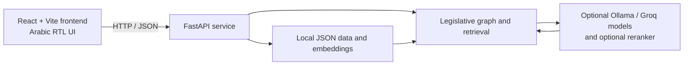

# معيار (Ma’yar)

**Jordanian legal intelligence and legislative relationship explorer**

Ma’yar is an Arabic-first, right-to-left web application for exploring Jordanian legislation, asking questions against a legislative knowledge graph, reviewing contract clauses and draft laws, and tracing recorded legal relationships. The frontend is a React single-page application; a FastAPI service supplies article, graph, retrieval, audit, and ingestion operations.

> **Important:** Ma’yar is a research and decision-support tool, not a substitute for an official gazette, a qualified Jordanian lawyer, or independent legal review. AI-generated answers and inferred relationships can be incomplete or incorrect.


## Contents

- [At a glance](#at-a-glance)
- [Capabilities](#capabilities)
- [Architecture](#architecture)
- [Repository layout](#repository-layout)
- [Technology](#technology)
- [Requirements and setup](#requirements-and-setup)
- [Configuration](#configuration)
- [API reference](#api-reference)
- [Data and graph model](#data-and-graph-model)
- [AI and retrieval behavior](#ai-and-retrieval-behavior)
- [Evaluation & Benchmark Results](#evaluation--benchmark-results)
- [Frontend behavior](#frontend-behavior)
- [Ingestion and maintenance](#ingestion-and-maintenance)
- [Verification](#verification)
- [Security, privacy, and legal limitations](#security-privacy-and-legal-limitations)
- [Known limitations and follow-up work](#known-limitations-and-follow-up-work)
- [License and attribution](#license-and-attribution)

## At a glance

| Area | Details |
| --- | --- |
| Product | معيار (Ma’yar), an Arabic-first Jordanian legal intelligence platform |
| Frontend | React, React DOM, React Router, Vite, Tailwind CSS, Cytoscape.js |
| Backend | FastAPI application in `backend/` |
| Default API | `http://127.0.0.1:8000` |
| Frontend API override | `VITE_API_URL` |
| Data storage | Local files under `data/`; no database service is configured |
| Interactive documentation | FastAPI Swagger UI at `http://127.0.0.1:8000/docs` |
| Current legal-data snapshot | A read-only check during this documentation work returned 1,031 articles, 1,032 graph nodes, and 593 graph edges. Ingestion or data updates can change these totals. |

## Capabilities

- Arabic RTL dashboard with article, node, edge, and relationship summaries.
- Searchable legislation library and article detail views with status, source, tags, and related articles.
- Legislative graph with Cytoscape.js, status and relation filters, text search, zoom controls, and an accessible node list.
- A graph-page **Conflict Lab** filter for recorded repeal, amendment, and overlap relationships. Selecting an edge compares its two endpoints using graph data.
- Legislative change summaries for repeals, amendments, and overlaps.
- Arabic legal question answering through `POST /ask`, with the engine mode, verdict, evidence articles, and detected relations.
- Contract-clause and draft-legislation review through `POST /audit`, including findings, reasoning, references, and a suggested rewrite when returned by the service.
- Timeline views based on article metadata.
- Text/file ingestion and embedding-rebuild controls. These operations change local backend data and should be treated as administrative actions.
- Responsive layouts and Arabic-friendly legal text presentation.

The Conflict Lab reports relationships present in the returned graph. In particular, an `overlaps_with` edge is a recorded relationship, not by itself a legal conclusion that two provisions conflict.

## Architecture



The browser does not read the data files directly. The API builds article and graph responses from the local data, performs retrieval and impact analysis, and may call configured language models. The frontend handles presentation, navigation, client-side graph filters, and API error states.

## Repository layout

```text
.
├── backend/                 FastAPI routes, graph engine, retrieval, audit, and model clients
├── data/                    Legislation records, embeddings, ingestion material, and related data
├── frontend/
│   ├── public/assets/       Static brand assets
│   ├── src/
│   │   ├── components/      Shared layout, UI, and legislation components
│   │   ├── context/         Shared frontend state
│   │   ├── pages/           Dashboard, Ask, Audit, Graph, Timeline, and Ingest pages
│   │   ├── services/        HTTP API client
│   │   └── styles/          Active Tailwind/design-system styles
│   ├── .env.example         Frontend API URL example
│   └── package.json         Frontend dependencies and scripts
└── scripts/                 Data preparation and maintenance utilities
```


## Technology

### Frontend

Dependencies and scripts are declared in [`frontend/package.json`](frontend/package.json).

| Package | Declared version range | Purpose |
| --- | --- | --- |
| React / React DOM | `^19.1.0` | UI |
| React Router DOM | `^7.18.7` | Client-side routing |
| Cytoscape.js | `^3.30.4` | Interactive legal relationship graph |
| Vite | `^6.3.5` | Development server and production bundling |
| Tailwind CSS / `@tailwindcss/vite` | `^4.1.14` | Utility styles and Vite integration |
| `@vitejs/plugin-react` | `^4.7.0` | React support for Vite |

Available npm scripts:

| Command | Description |
| --- | --- |
| `npm run dev` | Start the Vite development server |
| `npm run build` | Create the production bundle in `frontend/dist/` |
| `npm run preview` | Serve the built frontend locally |

No frontend test or lint script is defined in `package.json`.

### Backend

The backend is Python/FastAPI. No backend dependency manifest or supported Python-version declaration was found during this audit. The application imports FastAPI/Pydantic and NumPy; file upload support requires the multipart parser used by FastAPI. PDF extraction and model/reranking features may need additional optional packages depending on the selected routes and deployment. Maintain a pinned, reviewed backend dependency file before deploying or setting up a reproducible environment.

## Requirements and setup

### Frontend

Install a supported Node.js/npm release, then:

```powershell
cd frontend
npm install
Copy-Item .env.example .env
npm run dev
```

The Vite server prints its local URL. Set the API URL in `.env` before starting Vite if the backend is hosted somewhere other than the default. Vite environment values are embedded at build time; rebuild after changing them.

For a production bundle:

```powershell
cd frontend
npm run build
npm run preview
```

### Backend

Create and activate a Python virtual environment, install the packages required by the backend features you plan to run, then start the application from the backend directory:

```powershell
cd backend
python -m venv .venv
.\.venv\Scripts\Activate.ps1
python -m pip install fastapi uvicorn numpy python-multipart
uvicorn app:app --reload --host 127.0.0.1 --port 8000
```

The command above covers the core API and multipart upload dependency; it is not a substitute for a backend lockfile. Install and configure any optional PDF, crawler, embedding, or reranking dependencies required by the specific feature being enabled. The backend exposes interactive API documentation at `/docs`.

The frontend and backend must both be reachable from the browser. The frontend displays an API connection status/error when service calls fail.

## Configuration

### Frontend

Copy `frontend/.env.example` to `frontend/.env` and set:

| Variable | Default | Description |
| --- | --- | --- |
| `VITE_API_URL` | `http://127.0.0.1:8000` | Base URL used by the browser API client. Trailing slashes are removed. |

Do not put backend secrets in a `VITE_*` variable: frontend values are public in the generated browser bundle.

### Backend model configuration

The backend reads configuration from its environment and, in some modules, a local `.env` file. Never commit real credentials. The following variable names were present in backend configuration/code; model-provider settings are consumed by different modules:

| Variable | Use |
| --- | --- |
| `GROQ_API_KEY` | Groq credential; keep it private and server-side. |
| `GROQ_MODEL` | Groq model selection where the shared LLM client uses it. |
| `LLM_PROVIDER` | Provider selection for the shared `llm_client` flow, including audit synthesis. |
| `OLLAMA_BASE_URL` | Ollama endpoint for the shared LLM client. |
| `OLLAMA_CHAT_MODEL` | Chat model for the shared LLM client. |
| `OLLAMA_URL` | Ollama endpoint used by other backend flows, including graph/ingestion code. |
| `OLLAMA_MODEL` | Model name used by those direct Ollama flows. |

The `/ask` graph-engine path includes its own Ollama/Groq selection and defaults; it does not necessarily share the exact same provider-selection behavior as audit synthesis. Check the relevant backend module before assuming a setting controls every route. A local Ollama installation and model downloads are optional for deployments using a configured remote provider or the non-LLM fallback.

## API reference

Base URL: `http://127.0.0.1:8000` by default. The API is defined in `backend/app.py`; request/response validation and interactive schemas are available at `/docs`.

| Method and path | Request | Response / behavior |
| --- | --- | --- |
| `GET /` | — | Service metadata/status. |
| `GET /health` | — | Backend health information used by the frontend shell. |
| `GET /graph/summary` | — | `total_articles`, `total_nodes`, `total_edges`, and `relations_by_type`. |
| `GET /graph` | — | Graph `nodes` and `edges`, plus graph-size/returned-count metadata. A node includes article or external-reference metadata; an edge includes `source`, `target`, `relation_type`, and optional `note`. |
| `GET /graph/changes` | — | `repeals`, `amendments`, and `overlaps` edge arrays. |
| `GET /graph/impact/{node_id}` | — | Impact summary including the root, impacted nodes, and impact paths. |
| `GET /articles?q={query}` | Optional search query | Array of matching article records. |
| `GET /articles/{identifier}` | Article ID or supported article identifier | `{ article, neighbors, impact }`. Prefer stable article IDs when available. |
| `POST /ask` | JSON containing `question`; an optional role may also be supplied by the UI | Question answer with `engine_mode`, conflict/overlap flag, verdict, evidence articles, and detected relations. |
| `POST /audit` | JSON containing `clause_text` and `mode` (`contract` or `draft`); the UI may also include a role | Structured compliance result, such as status, summary, violated articles, legal reasoning, suggested rewrite, and referenced articles. |
| `POST /ingest/text` | JSON text/source fields | Processes and stores a text document and its extracted legal information. |
| `POST /ingest/file` | Multipart file upload | Processes a supported document upload. |
| `POST /embeddings/rebuild` | — | Rebuilds the local embedding index. |

The article records commonly include `id`, `legislation_title`, `legislation_type`, `article_number`, `effective_date`, `status`, `topic_tags`, `text`, `relations`, and `official_source`. Exact optional fields depend on the source record and endpoint.

### Graph query parameter limitation

The frontend graph API client now builds `limit` (default `180`) and optional trimmed `legislation_title` query parameters for compatibility with the graph engine’s internal payload builder. **The current FastAPI `GET /graph` route does not declare either query parameter and calls the graph builder with its defaults. FastAPI therefore ignores these client query values today.** The graph page filters the returned graph client-side; this is not server-side filtering, and the backend was intentionally left unchanged.

## Data and graph model

- Article records are held in local JSON data under `data/`; the article list is not backed by a configured SQL database.
- The embedding index is stored locally and uses 1,024-dimensional vectors in the inspected dataset snapshot. Rebuilding the index can require model access and may be time- and resource-intensive.
- The graph represents article records and may also include external-reference nodes. Its relationships are directed source/target edges.
- Observed relation values include `repeals`, `repealed_by`, `amends`, `amended_by`, `overlaps_with`, `details_or_links`, `references`, and `semantic_link`. Other values may be present in future data.
- Common Arabic statuses include `ساري`, `ملغى`, and `معدل`; imported records may use other Arabic labels or neutral/reference statuses.
- The UI maps known relation values to Arabic badges. Unknown relation values use a generic relationship label.
- The graph endpoint uses a default node cap of 180 in the current backend call path. The full article catalogue and graph summary can therefore be larger than the subgraph currently rendered.
- The Conflict Lab only filters relationships and endpoints in the graph payload returned by `/graph`; it cannot reveal nodes omitted by that payload.

## AI and retrieval behavior

The service combines a local legislative graph, lexical retrieval, stored embeddings, and optional language-model synthesis:

1. `/articles?q=...`, `/ask`, and `/audit` retrieve article candidates from local legal records. Search can use Arabic-aware lexical matching and the available embedding index.
2. The inspected embedding entries use the BGE-M3 family and 1,024 dimensions. Query-embedding availability depends on the configured model service and installed backend dependencies.
3. `/ask` evaluates candidate evidence and graph relations, then may synthesize a response through Ollama or Groq. A graph/semantic fallback is used when a model provider is unavailable; this fallback is not equivalent to a qualified legal review.
4. `/audit` evaluates a contract clause or draft against retrieved article candidates. The optional reranker can reorder candidates when its package/model is available; exact results depend on the installed dependencies and model configuration.
5. Evidence, similarity scores, verdicts, and rewrites are model/retrieval outputs. They should be checked against the referenced legislation and official sources.

Model names and provider availability are runtime configuration, not guaranteed frontend features. A build does not verify connectivity to Ollama, Groq, or external model downloads.

## Evaluation & Benchmark Results

The project evaluation script, [`scripts/evaluate_qanoon.py`](scripts/evaluate_qanoon.py), defines small `/ask` retrieval and `/audit` compliance-classification benchmarks. The `/ask` values below are the measured results provided for the recorded evaluation run. `/audit` numerical results are not available in that run's recorded output and are intentionally not inferred.

### AI Legal Retrieval Evaluation — `/ask`

The retrieval benchmark uses three predefined Arabic legal questions and manually specified expected article IDs. The reported results are:

| Test case | Precision | Recall | F1-Score | Average Cosine Similarity |
| --- | ---: | ---: | ---: | ---: |
| Q1 — Employment contracts, duration, working hours, and occupational safety | 1.00 | 0.86 | 0.92 | 0.5933 |
| Q2 — Termination restrictions, annual leave, and overtime | 1.00 | 0.86 | 0.92 | 0.6112 |
| Q3 — Flexible work regulations and contractual obligations (2024) | 1.00 | 0.86 | 0.92 | 0.6775 |
| **Overall Average** | **1.00** | **0.86** | **0.92** | **0.6274** |

**Metric definitions**

- **Precision:** The proportion of retrieved legal articles that are relevant to the expected article set.
- **Recall:** The proportion of expected relevant legal articles successfully retrieved by the system.
- **F1-Score:** The harmonic mean of Precision and Recall.
- **Average Cosine Similarity:** The average cosine similarity of the retrieved evidence articles, used as a measure of semantic similarity between the query and retrieved content.

**Key findings:** This benchmark measured 100% retrieval precision across all three test cases, approximately 86% recall, approximately 92% F1-Score, and an overall average cosine similarity of 0.6274. These results indicate strong precision for this particular benchmark, while some expected legal articles were not retrieved.

Cosine similarity describes semantic similarity between text representations. It is not a probability, calibrated confidence score, or guarantee of legal correctness.

### Compliance Classification Evaluation — `/audit`

The script defines three contract-clause classification cases:

| Case | Scenario | Expected Classification |
| --- | --- | --- |
| A1 | Contract clause allowing termination without notice or legitimate reason | `non_compliant` |
| A2 | Contract clause recognizing the worker's entitlement to annual paid leave under Jordanian Labor Law | `compliant` |
| A3 | An unrelated clause concerning ship registration fees through the Suez Canal | `insufficient_evidence` |

The benchmark calculates classification accuracy and Macro-F1 by comparing each returned `compliance_status` with its expected classification. **The recorded execution output contains only the `/audit` evaluation section heading; it does not include individual predictions or the final accuracy and Macro-F1 summary. Numerical `/audit` results are therefore unavailable, and no claim that this benchmark passed is made.**

### Benchmark Methodology

Run the evaluation script from the repository root with:

```bash
python scripts/evaluate_qanoon.py
```

For `/ask`, the script sends each predefined Arabic question to the `/ask` endpoint, reads `evidence_articles`, compares the retrieved article IDs with the case's expected IDs, and calculates Precision, Recall, and F1-Score. It calculates each case's average from numeric `cosine_similarity` values in the retrieved evidence, then reports the arithmetic mean of the per-case metrics.

For `/audit`, the script sends each predefined clause and its mode to `/audit`, compares the returned `compliance_status` with the expected classification, and calculates accuracy and Macro-F1 from the resulting predictions. This README reports no audit metric without a recorded completed evaluation result.

### Benchmark Limitations and Transparency

- The `/ask` benchmark currently contains three predefined questions; the `/audit` benchmark defines three predefined classification cases.
- Expected article IDs and classification labels are the benchmark's reference answers. They are not an independent adjudication of every potentially relevant provision.
- These results are an initial evaluation snapshot, not a comprehensive independent assessment of legal accuracy.
- More test cases, broader legal coverage, and additional validation are needed before making stronger generalization claims.
- Retrieval performance measures how the system returns evidence against these reference sets; it is distinct from whether a legal interpretation is correct.

## Frontend behavior

- Navigation is routed through React Router; shared state and API status are handled by the frontend context and shell.
- The graph page loads `/graph` and `/graph/changes`, applies search/status/legislation/relation filters to the loaded graph, and calls `/articles/{identifier}` when a user selects an article node.
- Article details include the returned neighbors and impact information. The impact action can request `/graph/impact/{node_id}` and highlights affected graph nodes.
- Selecting an edge opens a comparison of both graph endpoints. Missing or external article metadata is shown as **غير متوفر في البيانات الحالية** rather than being presented as verified article text.
- The supplied brand image is integrated into the shared application shell’s global brand link and scales proportionally for desktop and mobile layouts.
- Arabic legal content is rendered with RTL direction where article text is displayed. The graph layout uses separated Cytoscape nodes; dense graphs can still require zooming or filtering.

## Ingestion and maintenance

Ingestion endpoints write or update local backend data and are not read-only:

- `POST /ingest/text` accepts text for extraction and graph enrichment.
- `POST /ingest/file` accepts supported uploaded documents (the frontend currently advertises PDF, TXT, and Markdown extensions).
- `POST /embeddings/rebuild` recalculates the embedding index.

Before using these operations on important data:

1. Back up the relevant `data/` files.
2. Confirm the selected model services and optional parsers are configured.
3. Review the API response and resulting records/relationships.
4. Keep backups and source documents according to your data-retention policy.

The frontend role selector is a presentation/workflow aid. It is not authentication or authorization for these endpoints.

## Verification

The frontend defines a production build command but no automated test or lint command. Run the existing production build to verify frontend bundling:

```powershell
cd frontend
npm run build
```

For API integration, start the backend and check `/health`, `/graph/summary`, `/graph`, `/graph/changes`, and the relevant article, ask, audit, and ingestion routes in `/docs`. Do not test write endpoints against a shared or important dataset without explicit authorization and backups.

## Security, privacy, and legal limitations

- **No authentication was identified on the frontend role selector or the documented data-changing API operations.** Do not expose ingestion or embedding-rebuild endpoints to untrusted users.
- Backend CORS is permissive in the inspected configuration. Restrict allowed origins and review credential behavior before any non-local deployment.
- Bind the development server to loopback unless there is a deliberate, secured deployment plan. `127.0.0.1` is the development default, not an internet deployment design.
- Keep `.env`, provider credentials, source documents, and any sensitive legal material out of public repositories and browser-side bundles.
- AI output can omit or misread provisions, return stale evidence, or suggest unsuitable wording. Verify against official sources and obtain qualified legal review.
- Official-source URLs are only displayed when available in the article data; the presence of a URL is not independent verification of its contents.
- Uploaded and ingested documents may be persisted in local backend data. Apply access controls, retention limits, backups, and deletion procedures appropriate to the material.
- This repository has no declared production threat model, authorization system, data-protection policy, or legal-advice warranty.

## Known limitations and follow-up work

Confirmed during the frontend/backend audit:

1. Expose and validate `limit` and `legislation_title` on the FastAPI `/graph` route if server-side graph selection is required. Until then, frontend graph filtering is local to the capped response.
2. Add a backend dependency manifest with pinned, tested versions and document the supported Python range.
3. Add automated frontend tests for API request shapes, filters, and key user flows; add linting/type checks if adopted by maintainers.
4. Add server-side authentication/authorization for ingestion and rebuild operations, and tighten CORS for deployment.
5. Review the legal dataset, embedding index, imported documents, and model provenance/refresh process as operational data rather than source-code guarantees.
6. Minor unused UI symbols (`StatCard` import in `IngestPage.jsx` and `ArticleReference` export in `UI.jsx`) remain to be cleaned up.
7. No repository license file or explicit license grant was found. Ask the maintainers before redistributing or reusing this project.

## License and attribution

All rights reserved to the project author (Ayham Almajali). Please contact the repository maintainer before redistributing or reusing the codebase or dataset.

The Ma’yar brand mark is located at [`frontend/public/assets/maeyar-logo.png`](frontend/public/assets/maeyar-logo.png). Official Jordanian legislative texts belong to their respective issuing authorities.